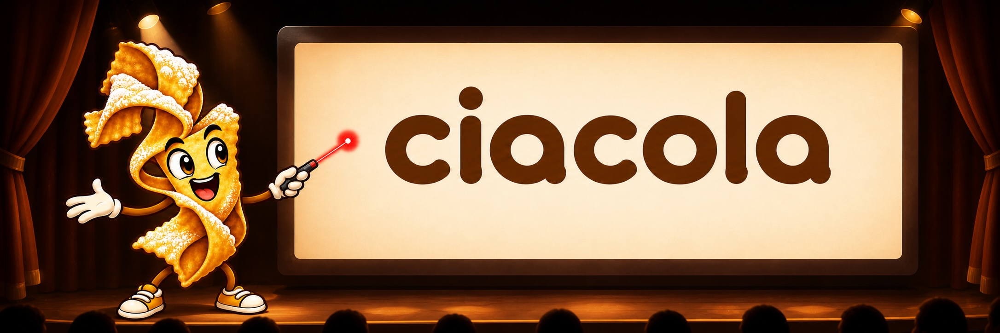

**Ciacola** is an experimental foundation for one Compose Desktop conference talk. Its name comes
from Venetian *ciàcola* — a chat or conversation — and is pronounced roughly “CHAH-koh-lah”.

The deck uses [Storyboard](https://github.com/bnorm/storyboard) for scenes, state, navigation,
transitions, shared elements, and fixed-resolution rendering. The `deck` module adds the visual
language and a small set of provisional scenes. It is a spike, not a presentation framework and
not the talk's narrative.

## What is here

The sample deck has four scenes and nine states. Together they exercise:

- deterministic forward and backward navigation;
- a shared-bounds, Magic-Move-style transition;
- animation that keeps running without advancing the scene;
- an animated mesh made from indexed Compose `Vertices`;
- MagicText transitions for prose;
- MagicText transitions for syntax-highlighted Kotlin; and
- a single 1920×1080 design system for type, colour, and spacing.

All visible copy is marked provisional on purpose.

## Run it

The build uses a JetBrains Runtime 25 toolchain for the desktop application. Gradle downloads it
automatically when necessary:

```shell
./gradlew :deck:run
```

Use the left and right arrow keys to move through the deck.

## Project layout

| Path | Purpose |
|---|---|
| [`deck/`](deck/) | Desktop application, scenes, design system, mesh effect, and text-engine binding |
| [`storyboard-text/`](storyboard-text/) | Upstream MagicText with focused hardening and tests |
| [`docs/DECK-FOUNDATION.md`](docs/DECK-FOUNDATION.md) | Architecture, source notes, attribution, retained TODOs, and verification record |
| [`docs/MAGIC-TEXT-V2-SEAM.md`](docs/MAGIC-TEXT-V2-SEAM.md) | Design boundary and fixtures for a future paragraph-layout renderer |

The other modules are the original Storyboard checkout and examples.

## MagicText work

The existing renderer remains in use. This branch tightens a few parts of its behaviour:

- Unicode tokenization no longer splits surrogate pairs, common emoji sequences, or combining
  marks from their base word;
- unchanged whitespace keeps stable correspondence keys;
- settled transition state is recorded as a Compose side effect;
- returning to an interrupted target reuses its shared-bounds plan; and
- repeated tokens, line breaks, style changes, large inputs, annotations, and representative
  difficult scripts are covered by tests.

The deck sees text rendering through one application-level `DeckTextRenderer` binding. That is the
replacement point for future work; scenes do not choose between engines.

MagicText v2 is not implemented here. Neither are text shaping, glyph extraction, Canvas text
rendering, or the unfinished gradual-entrance renderer. The intended boundary is documented in
[`MAGIC-TEXT-V2-SEAM.md`](docs/MAGIC-TEXT-V2-SEAM.md).

## Checks

Run the focused suites with:

```shell
./gradlew :storyboard-text:jvmTest :deck:desktopTest
```

The full non-browser gate is:

```shell
./gradlew check --no-parallel -Pkotlin.daemon.jvmargs=-Xmx4g -x wasmJsBrowserTest
```

The browser tests inherited from Storyboard expect ChromeHeadless. They are excluded above so the
gate also works in environments without Chrome; JVM tests, Wasm compilation, and API checks still
run.

## Upstream and licence

Ciacola is a fork of Brian Norman's
[Storyboard](https://github.com/bnorm/storyboard), based on revision
`499cda890a7591c8fc56044726531f6f38a82e35`. This repository retains Storyboard's Git history and is
distributed under the same [Apache License 2.0](LICENSE.txt). See [NOTICE](NOTICE) for attribution.

The vertex-mesh technique was studied in
[Sina Samaki's ChromaDecks](https://github.com/sinasamaki/ChromaDecks), and the shared-text approach
was compared with
[Brian Norman's Magic Move deck](https://github.com/bnorm/deck.bnorm.dev/tree/dcnyc25/dcnyc25/story).
Neither reference repository exposed a licence file at the revisions studied, so no source or assets
were copied from them. Exact revisions and source locations are recorded in
[`DECK-FOUNDATION.md`](docs/DECK-FOUNDATION.md).
